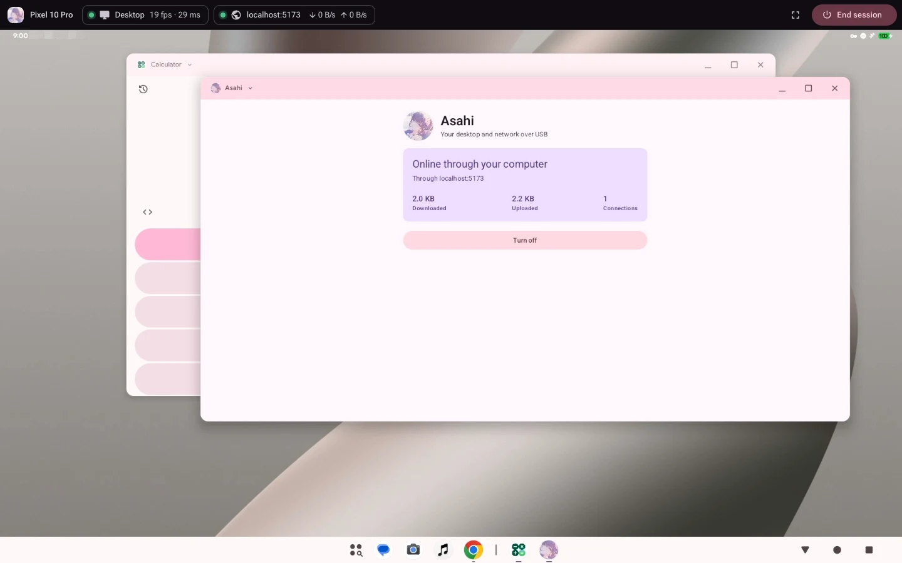
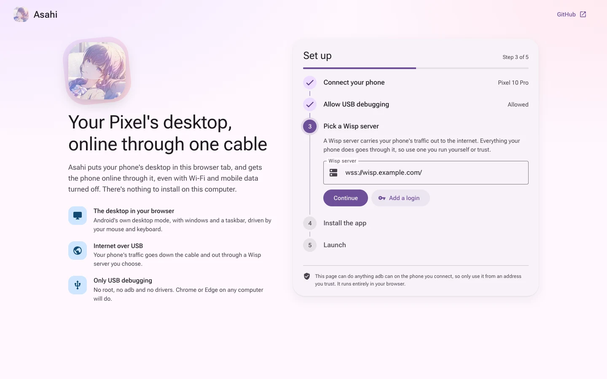

<p align="center">
  
</p>

<h1 align="center">Asahi</h1>

<p align="center">Use your phone, its apps and its Linux machines from a browser tab, online through one cable.</p>

<p align="center">
  <a href="https://github.com/wonderhoy-labs/asahi/actions/workflows/ci.yml"></a>
  <a href="LICENSE"></a>
  <a href="#license-and-credits"></a>
</p>

Asahi lets you use your whole phone from a web page. Plug it into a computer, open the page in Chrome, and pick what you want
to see: Android's own desktop mode, the phone's screen, any one of its apps, or the Linux apps and machines it runs through
[Airi](https://github.com/wonderhoy-labs/airi) and [Minori](https://github.com/wonderhoy-labs/minori), all with your mouse and
keyboard. Meanwhile everything the phone does goes down the cable and out through a
[Wisp](https://github.com/MercuryWorkshop/wisp-protocol) server, so it works with the phone's Wi-Fi and mobile data turned off.

There's no root on the phone, and no `adb`, drivers or anything else on the computer. Asahi is the Wonderhoy Labs projects'
web front, built on their libraries: [Shira](https://github.com/wonderhoy-labs/shira)'s app gives the phone its network,
[Shinonome](https://github.com/wonderhoy-labs/shinonome)'s server, which runs without installing anything, shows Android, and
Minori's helper shows its machines.



> **This is early.** We've tested it on one Pixel 10 Pro running Android 17 with a Mac, and on an Android 17 emulator.
> [Here's exactly what that covers](#what-has-been-tested), including the parts we couldn't test yet. If you try anything else,
> please [open an issue](https://github.com/wonderhoy-labs/asahi/issues) and tell us how it went, even if it just worked.

## What you need

- A phone whose Android build can put the desktop on a virtual display. Android 17 on the Pixel 10 Pro can. If yours gets
  refused, turn on **Enable desktop experience features** in Developer options and reboot. Phones that can't still get the
  network part, on Android 10 or newer.
- **USB debugging** turned on in Developer options, and a USB cable that carries data.
- A computer with Chrome, Edge or another Chromium browser. Safari and Firefox don't have WebUSB.
- A Wisp server. [Here's what to look for.](#wisp-servers)

## Use it

Open **<https://wonderhoy-labs.github.io/asahi/>** and follow the five steps, the last of which is choosing what to show. Nothing happens to your phone until you click
something.



1. **Connect your phone.** Plug it in, click **Connect phone** and pick it from the browser's list.
2. **Allow USB debugging.** Unlock the phone. If it asks whether to allow USB debugging, tick **Always allow from this
   computer** and tap **Allow**. A browser you've allowed before carries on by itself.
3. **Pick a Wisp server,** like `wss://example.com/wisp/`. The page connects to it once to check, and asks for a login if the
   server wants one. It remembers the last few you used.
4. **Install the app.** Asahi's app on the phone is [Shira](https://github.com/wonderhoy-labs/shira), and the page carries it.
   The page shows whether it's there and which version. **Install it for me** does it through USB debugging, **I'll install it
   myself** gives you the APK and notices when it's on the phone, and **Check again** looks again. If it's already current,
   **Continue** carries on. You can also get it from [Shira's releases](https://github.com/wonderhoy-labs/shira/releases). The
   desktop needs nothing installed.
5. **Choose and launch.** Pick what to show from six cards (Android desktop, Android screen, Android app, Linux app, Linux
   desktop and Linux console), and the app or machine if it needs one. Cards for what your phone can't do say why, such as a
   phone without desktop windows or without Airi or Minori. The page remembers your choice for next time. **Launch** turns on
   the network, connects it to your server, and starts what you picked. Shira gets Android's VPN
   permission through USB debugging, the same as tapping OK on the phone's own dialog.

Then you're in. The bar at the top shows the desktop's frame rate and delay, and the network's speed. Click the network to see
every connection your phone makes. **Fullscreen** gives the desktop the whole screen, and you hold Esc to leave.

Only one program can use USB debugging at a time, so if you have `adb` on this computer, stop it first. Close Android Studio
and any WebADB tabs too.

```bash
adb kill-server
```

Keep the tab open. It carries both the desktop and the network, so closing it takes your phone off the network within about 10
seconds, and the desktop ends by itself after 2 minutes. If the cable comes out, plug it back in and the page carries on.

To stop, click **End session**. The desktop's windows go back to the phone, the phone goes back to its own network, and USB
debugging is free for other tools again.

### While a session runs

The desktop takes the shape of your browser window, up to about 1920x1200, so there are no bars around it. Opening the network
panel gives the panel its own room, and the desktop reshapes to fit what's left.

Your phone's screen turns off when the desktop connects, and the phone stays awake and unlocked behind it. You can still lock it
with the power button. The desktop keeps going, and pressing the button again shows the lock screen so you can use your phone.
When the session ends, the phone locks if its screen was off.

Keys are sent by position, as on a US keyboard. On a Mac, Cmd acts as Ctrl, because that's what Android's shortcuts expect.

The phone's sound plays in the page once you've clicked or typed in it, because browsers only allow sound after that. The
speaker button in the top bar sends it back to the phone. Paste with your computer's usual shortcut to paste its text on the
phone, and copy on the phone to put text on your computer's clipboard. Drop files on the desktop to save them in the phone's
Downloads.

Sharp mode, the **HD** button, gives the desktop your phone's own density, with more pixels to keep the same room. Text is
sharper, and apps like Discord lay out properly, but each frame takes longer: about 24 ms from capture to decoded instead of
14, in Shinonome's measurements of the same code. When an app that needs it comes to the front with sharp mode off, the page
offers to turn it on, and turning it on restarts those apps with their windows where they were.

### What the tab shows

You choose before **Launch**, and the menu at the top left switches later. The network keeps running whichever you pick:

- **Android desktop**: Android's desktop mode, the usual. Only offered when the phone can make one; the page asks Shinonome's
  server before Launch, and shows Android's reason when it can't.
- **Android screen**: your phone's own screen, as it is, the way scrcpy shows it. The phone's screen stays on.
- **Android app**: any app on the phone's launcher, picked from a grid of their names and icons with a search box. It runs on
  a display of its own, fills the tab, and follows the window's size, portrait too.
- **Linux app**, with [Airi](https://github.com/wonderhoy-labs/airi) 0.3.0 or later on the phone: one of the Linux apps in
  Android's terminal, or in a Minori machine Airi is set up in, alone in the tab like an Android app.
- **Linux desktop** and **Linux console**, with [Minori](https://github.com/wonderhoy-labs/minori) on the phone: a machine's
  desktop, if it has Minori's guest agent, or its console. Picking a machine starts it if it's stopped. Minori's Termux
  userlands are labelled Termux, and offer their console.

Android's desktop, its screen and one app take turns, so switching between them closes the one before; the desktop's
windows go back to the phone, and one app closes. A machine shows beside them, so what Shinonome had keeps running.

### The network log

Every connection gets a row, newest first, with the app that made it, the destination, its status and how much went each way.
Click one for the details. You can search by name, address, app or port, filter by what's active, failed, DNS or UDP, and save
the whole log as JSON.

The log only exists in that tab. It's never sent anywhere, and it's gone when you close it.

## Use it in your app

Asahi is two libraries in one page, and you can put them together the same way in yours:
[`@wonderhoy-labs/shira`](https://github.com/wonderhoy-labs/shira#use-it-in-your-app) for the network and
[`@wonderhoy-labs/shinonome`](https://github.com/wonderhoy-labs/shinonome#use-it-in-your-app) for the desktop. Each carries its
own APK, and both work over one `adb` connection from [Tango](https://github.com/yume-chan/ya-webadb):

```ts
import { DesktopSession, Phone as DesktopPhone, runDesktopLink } from "@wonderhoy-labs/shinonome";
import shinonomeApk from "@wonderhoy-labs/shinonome/shinonome.apk?url";
import { LogStore, Phone as NetworkPhone, ShiraLink } from "@wonderhoy-labs/shira";

const bytes = async (url: string) => new Uint8Array(await (await fetch(url)).arrayBuffer());

const network = new ShiraLink({
	phone: new NetworkPhone(adb, "My phone", "usb"),
	serverUrl: "wss://wisp.example/",
	credentials: null,
	log: new LogStore(),
	events: {},
});
network.start("auto");

const desktop = new DesktopPhone(adb, "My phone");
if (!(await desktop.isServerRunning())) await desktop.startServer(await bytes(shinonomeApk));
await runDesktopLink(await desktop.openDesktopSocket(), new DesktopSession(canvas, {}));
```

Asahi's own [`controller.ts`](web/src/asahi/controller.ts) is the whole of it, with the onboarding, reconnecting after a replug,
and ending a session. Add the wisp-js fork next to Shira's library, as its README says.

## Wisp servers

A Wisp server turns a WebSocket into TCP and UDP connections. All your phone's traffic goes through it, so use one you run
yourself or trust. [wisp-js](https://github.com/MercuryWorkshop/wisp-js) and
[epoxy-server](https://github.com/MercuryWorkshop/epoxy-tls) are two you can host.

From a site served over HTTPS, as the official page is, the browser only allows `wss://` addresses, apart from `ws://localhost`.

Asahi needs these from a server:

- **Connections to IP addresses.** The phone asks 1.1.1.1 for addresses, and apps connect to those. A server with
  `allow_direct_ip` turned off, as wisp-js calls it, refuses everything.
- **TCP to port 53 on 1.1.1.1**, for DNS.
- **UDP, if you want it.** Without it, apps that try QUIC are told straight away that it won't work, and they fall back to TCP.

It speaks Wisp version 2, and falls back to version 1. It shows a server's welcome message on the Launch step. For logins it does
the password extension, which it only ever sends to a server that asked for it. The password stays in the tab's memory, so you
enter it again after a reload. Key-based logins aren't supported.

> **If you host wisp-js:** in the npm release, when a destination closes a connection, the server throws away whatever it hasn't
> sent on yet, so a fast download can get cut short with no error. The `fixes` branch of
> [our fork](https://github.com/wonderhoy-labs/wisp-js/tree/fixes) fixes that, and epoxy-server is another way around it.

## What has been tested

Everything here is on a Pixel 10 Pro running Android 17 (build `CP3A.260905.009`, not rooted), with a Mac, except where
it says an emulator.

**Asahi 0.4.0's choice of what to show and one Android app,** through the development server's page and its link to `adb`,
with Shinonome 0.5.0's library built from its branch, and again with the released 0.5.0 and Shira 0.2.2, where the
Pixel listed 125 apps and showed Clock alone. These ran in the Claude app's browser pane, because the Chrome
extension wasn't connected; sessions were left by reloading the page, since ending one there has crashed the pane before.

- On an Android 17 emulator, which can't make a desktop: the **Android desktop** card was greyed out with Android's reason
  ("This device does not support desktop windows…"), and **Android screen** was picked instead. Minori 0.1.1 there never
  answered, so the Linux cards said so after 20 seconds, with **Ask Minori again**. **Android app** listed 23 apps with their
  icons; Clock launched alone filling the tab, a click opened its Alarms, and Settings came up the same way from the live
  view's **One Android app** dialog. A wider tab reshaped Settings to 1920x964.
- On the Pixel 10 Pro: all six cards were offered, the last choice (Settings) came back picked after a reload, and the
  grid listed 125 apps. Settings alone took clicks and keys (typing "bat" filtered its search), Google's Calculator gave
  42 for 7 × 6 =, and a tall 700x900 tab gave Calculator a portrait 1200x1460 display. GNOME Calculator through Airi and
  the Xfce machine's console worked as before.
- **The stuck "Waiting for the first picture."** It was reproduced on the Pixel with 0.3.0's code by going from the
  desktop to the Xfce console and back: re-attaching the canvas opened a link to the old server, whose first frame used up
  the session's only first-picture event before the new server started. With the fix, on the Pixel, one app → desktop, desktop →
  Xfce console → screen, screen → Xfce console → desktop, desktop → GNOME Calculator and GNOME Calculator → Google's
  Calculator each cleared the notice when the new picture arrived, and so did Clock → screen → Settings on the emulator.
- Not tried: real Chrome or WebUSB for any of this, a Linux desktop or console card launched straight from the onboarding,
  and Minori's Termux userlands, which need F-Droid's Termux; the Pixel has Google Play's.

 in the development server's page with Shinonome 0.4.0. The emulator can't
make a desktop, and the page said so. **Pixel screen** showed the emulator's own screen at about 20 frames per second.
**One Linux app** listed two apps from Airi 0.3.0, which was pointed at a stand-in for its Linux agent, since the emulator
can't run Linux; picking one restarted Shinonome with just that app, and the tab showed Airi opening it, filling the tab.
Switching back and forth between the screen and an app worked each time. A Minori machine's desktop and console were
tried earlier the same way.

**The source menu on the Pixel,** in Chrome through the development server's page, with Shinonome 0.4.0, Airi 0.3.0 and
Minori 0.2.0 release builds. **Pixel desktop** came up as before. **Pixel screen** showed the phone's own screen, with
Shira's connected card on it. **One Linux app** listed the ten apps Airi found in the Linux terminal; picking Calculator
showed GNOME Calculator alone in the tab at up to 59 frames per second, and clicking 7 × 6 = gave 42. Switching back to
**Pixel desktop** worked. With an Xfce machine made from Minori's store on the phone, the menu listed **Xfce: desktop**
and **Xfce: console**: the desktop showed Xfce with its Applications menu opening on a click, and the console showed the
machine's login prompt. Not tried: a Minori machine's one app, which needs Airi set up inside that machine.

**Shira 0.2.1's fix for ending a session, on an Android 17 emulator.** In Chrome 156 through the development server's
link to `adb` and its Wisp server: **Install it for me** put Shira 0.2.1 on the emulator, **Launch** brought its VPN up, a
Wikipedia page opened in the emulator's browser, and 8 seconds later **End session**. With Shira 0.2.0 the tab crashed as
the session ended, in the one try. With 0.2.1 the page kept answering and the VPN went down, in both tries. This hasn't been
tried on the phone or over WebUSB.

**Asahi 0.2.0, on Shira's and Shinonome's libraries, in Chrome through the development server's link to `adb`.** The real
page, with Shira 0.2.0 and Shinonome 0.3.2 from their releases:

- **Update it for me** took the phone's Shira from 0.1.0 to the 0.2.0 the page carries, in place.
- **Launch** brought up Shira's VPN and started Shinonome's server from the APK the page carries, without installing it, and
  the desktop showed its picture. Dragging a window ran at 68 to 72 frames per second, 17 to 18 ms from capture to decoded
  at the median and 31 to 32 ms at the 95th percentile.
- **Sound** came on with a click on the desktop, while a test window on it played a tone: 110 packets in a row with no
  stalls or underruns, 12.5 ms from capture to arrival at the median and 16 ms at the 95th percentile, and about 38 ms of
  output delay in the browser on top.
- **End session** turned the VPN off and stopped the server, and with `--screen-on` the phone stayed unlocked.

**Asahi 0.1.0, which had its own app.** That app was Shira's and Shinonome's code under Asahi's name, and the page was the same
steps on copies of their code, so these still describe what the libraries do. In Chrome 156, through the development server's
link to `adb`:

- Connecting, finding no app, **Install it for me** with the release APK, then finding it installed on the next visit.
- Checking a Wisp server, and **Launch**: the VPN came up, the desktop started, and the page showed it at 90 to 119 frames per
  second while windows changed, with 29 to 53 ms from capture to decoded by the page's own count.
- With the phone's Wi-Fi off and no mobile service, Wikipedia loaded in Chrome on the phone's desktop. The network log showed
  Chrome's QUIC and the phone's DNS lookups.
- Clicks, typing, Cmd+A and Enter on the desktop, opening apps from its taskbar, and reshaping the desktop when the network panel
  opens and closes.
- Updating the app during a session: the page said the network had stopped, the desktop kept going, and turning it back on
  from the page brought the network back.
- Reloading the page during a session and launching again picked up the running desktop, with its windows where they were.
- **End session** stopped the desktop server and the VPN, and left the phone as it was before.

**Real USB, through the same WebUSB code outside a browser.** Tango's WebUSB backend, which the page uses, ran in Node with
[node-usb](https://github.com/node-usb/node-usb) in place of the browser's WebUSB. The phone asked about the new key, and after
Allow the desktop started, took a new shape and streamed with no dropped frames, while a 256 MiB download ran on the same
connection at 137 Mbit/s. Stopping it ended the server.

**On an Android 17 emulator,** the network came up and the page explained that the emulator can't make a desktop, with the
network still working. The app's own screen was checked there in light and dark.

**Not tried yet:** picking the phone in a browser's own WebUSB list, which needs a person to click it, so the whole flow hasn't
run over WebUSB inside a browser. Also replugging the cable, the screen turning off during a session (our test sessions kept it
on so that the phone wouldn't lock, though that code is Shinonome's and was tested there), password logins, other phones,
Windows, Linux and Edge.

## How it works

```
                 apps on the phone                       the desktop
                        │ IP packets                          │ Android's own desktop mode
                        ▼                                     ▼
   Shira's app: VPN, with TCP, UDP and DNS ending here   virtual display ── H.264 encoder
                        │ Wisp packets                        │ (Shinonome's server, shell user)
                        ▼                                     ▼
           localabstract:shira                     localabstract:shinonome
                        └────────────── adb over USB ─────────┘
                                          │
                               the page, over WebUSB
                        ┌─────────────────┴─────────────────┐
              wisp-js to your Wisp server         WebCodecs to a canvas
                        │                                   ▲
                   the internet                  your mouse and keyboard
```

The page speaks `adb` over WebUSB with [Tango](https://github.com/yume-chan/ya-webadb), the library behind WebADB. One `adb`
connection carries everything: a socket to Shira's app for the network, a socket to Shinonome's desktop server, and the shell
commands that install and start things. Each socket is its project's, and described there:
[Shira's](https://github.com/wonderhoy-labs/shira/blob/main/docs/protocol.md) and
[Shinonome's](https://github.com/wonderhoy-labs/shinonome/blob/main/docs/protocol.md).

### The network

This is Shira, through its library and its app. Normal apps can't use a phone's USB port as a network, but they can be a VPN,
which receives every packet the phone sends. Shira's app does that and ends the connections right there, in a small TCP stack written in Kotlin that acts as the
other end of every connection and turns each one into a Wisp stream. The page hands those to
[wisp-js](https://github.com/MercuryWorkshop/wisp-js), which keeps the connection to your server.

The app has no INTERNET permission, so its only way out is the cable. The VPN only exists while the page is attached and
connected to a Wisp server. Android is told the VPN is a real network, so apps don't think they're offline when there's nothing
else.

DNS goes to a resolver that exists only inside the app. It answers from a small cache, or asks `1.1.1.1` over a Wisp TCP stream.
The VPN is IPv4 only.

### The desktop

This is Shinonome, through its library and its server. Android decides whether a display gets the desktop by how the display was created, not by whether there's a
real monitor. A virtual display with the `TRUSTED` and `ALLOWS_CONTENT_MODE_SWITCH` flags gets the taskbar, title bars and window
management like a monitor you just plugged in. Asahi doesn't reimplement any of that.

Normal apps can't create a trusted display, but the shell user that `adb` runs as can. So the page carries Shinonome's APK,
copies it to the phone without installing it, and starts the server inside it with `app_process` through `adb`, using
Shinonome's start script. The server creates the display, encodes it
with the phone's H.264 encoder at low-latency settings, and injects your input into it. The page decodes with WebCodecs and draws
to a canvas. The encoder is asked to run at up to 480 frames a second, which finishes each frame in about 9 ms instead of 18,
and pointer moves go out at most every 4 ms in as few USB transfers as possible. Over WebUSB that comes to about 12 ms from
capture to arrival.

Sound comes from Android's remote submix, as scrcpy's does, in 10 ms packets of raw PCM, and the page keeps about 30 ms of it
queued. The clipboard goes through Android's clipboard service. Android shows "Shell pasted from your clipboard" on the phone's
own screen each time the phone's clipboard is sent to the page.

A virtual display shares the phone's power state, so the desktop would go blank as soon as the phone slept. During a session the
server wakes the phone whenever it sleeps and turns off only its screen.

When the desktop ends, Android moves its windows back to the phone. They come back to the same places next time.

**Pixel screen** asks Shinonome's server for a mirror of the phone's own display instead, and **one app** for a display of
its own that isn't a desktop, with only that app on it, opened by its link: `airi://app/<desktop file ID>` for Airi, or
`minori://vm/<machine>/app/<desktop file ID>` for a Minori machine, which starts the machine first. Airi's apps are listed
over `adb` through Airi's own content provider.

## Security and privacy

Worth reading before you use this.

**The page has the same access as `adb`.** Code on it can do anything `adb` can on the phone you connect, including installing
apps, so only use the address above or a copy you host yourself. It runs nothing from elsewhere, and its content security policy
keeps it that way. The key your phone trusts stays in that browser's profile. To take that trust back, use **Revoke USB debugging
authorizations** in Developer options.

**While the desktop runs, whoever has the page can use your apps without your PIN,** even with the phone locked. That's the
trade-off for only unlocking once. It ends when you end the session, close the tab or unplug for more than 2 minutes.

**The Wisp server carries all your phone's traffic.** It sees where your phone connects and anything that isn't encrypted,
including your DNS questions. HTTPS is still HTTPS. Asahi adds no encryption of its own past the `wss://` to the server, and a
`ws://` address has none at all. 1.1.1.1 sees your DNS questions too.

**Other apps on the phone are kept out.** Shira's socket and the desktop server's socket both refuse connections from anything
but `adbd`. Any app could listen on those names first, so the page only connects once it has checked that Shira's own service,
or Shinonome's server, holds them. Only `adb` can open the screen that turns the network on.

**Launching gives Shira the VPN approval,** the same as the phone's dialog would. It stays until you uninstall Shira, like
any VPN's. It also grants the notification permission, so that you can see it's running. Shira replaces any other VPN while
it's on, and that one doesn't come back by itself.

## Troubleshooting

**Your phone isn't in the browser's list.** Check that USB debugging is on and that the cable carries data. The list only shows
devices with an `adb` connection.

**"Something else on this computer is using USB debugging".** Only one program can use it at a time. Close any WebADB tabs, quit
Android Studio, and run `adb kill-server`, because other tools can start `adb` again by themselves.

**It stays on "Allow USB debugging".** Unlock the phone. If the prompt never comes, unplug the cable and plug it in again.

**"Your phone can't make a desktop".** Your Android build doesn't extend the desktop to virtual displays. Try turning on **Enable
desktop experience features** in Developer options and rebooting. The network works either way.

**Shira won't install.** Play Protect may ask about it, because it's not from the Play Store. The page tells you Android's
reason if it's anything else. **"Signed with a different key"** means you have a copy of Shira from somewhere else, like your
own build. Remove it with the button on the page.

**You still have the Asahi app.** Asahi 0.1.0 had an app of its own. From 0.2.0 Asahi uses Shira's app and Shinonome's server
instead, so you can uninstall the old one.

**Launch stays on "Turn on the network".** Unlock the phone, because a locked phone can't open the app. If it's asking about a VPN
connection, tap **OK**. If another app is set as an always-on VPN, turn that off in Settings, under Network & internet, then VPN.

**Pages don't load, but the log shows connections failing.** Click a few rows. "Blocked by the server" means it refuses that
address or port, and the [server's needs](#wisp-servers) above are a good place to start. If DNS rows fail, it can't reach
`1.1.1.1:53`.

**Windows have no title bars and you can't drag them.** Another virtual desktop is running, like the one in Shinonome's app on the
phone itself. Asahi runs Shinonome's own server, so starting it ends a Shinonome session from a computer, and closes the desktop
in Shinonome's app when it can. If that didn't happen, close it there and launch again.

If you're reporting a bug, please include your phone model, Android build number, browser version and which Wisp server software
you're using. The JSON you can save from the log can help, but look through it first, because it lists everywhere your phone
connected.

## Known issues

- `ping` doesn't work, because Wisp only carries TCP and UDP. Apps that check connectivity by pinging may say they're offline.
- No IPv6. An IPv6 attempt would look like it worked and then fail, instead of falling back the way apps normally do.
- An app's connection looks like it succeeded before the server has tried it, because Wisp doesn't confirm connections.
- Wisp has no half-close, so a server that waits for the app to finish sending before it answers won't answer.
- Traffic to your local network goes to the Wisp server too, which usually refuses it.
- Discord, and other React Native apps, come apart on the desktop without sharp mode, because they lay out at the phone
  screen's density whatever display they're on. The page offers sharp mode when one is in front, and turning it on restarts
  them, which closes anything open in them, a call included. Sharp mode costs some latency, so it's off by default. The
  offer is Shinonome 0.3.3's, tested there on the Pixel, and hasn't been run in Asahi's page yet.
- Only text crosses the clipboard, and not while the phone is locked.
- Keys go by position, so non-US layouts type the wrong characters.
- Touch on the desktop hasn't been tried.

## Development

You need Node 24 or newer with pnpm. There's no Android project: the phone's side comes with the two libraries.

Asahi follows the [Wonderhoy Labs guideline](.claude/skills/wonderhoy-unification/SKILL.md), like every Wonderhoy Labs project.
Format before you commit, and check the result:

```bash
pnpm install && pnpm format && pnpm unify
```

| Where | What's in it |
| --- | --- |
| `web/src/asahi/controller.ts` | Everything the page does, step by step, on Shira's and Shinonome's libraries |
| `web/src/adb/` | Reaching the phone over WebUSB or the development `adb` server, as one `Phone` with a network side and a desktop side |
| `web/src/ui/` | The page's screens, in React with [mdui](https://github.com/zdhxiong/mdui) for Material 3 |
| `web/plugins/` | The Vite plugin: the version of Shira the page carries, the notices, and the development servers |
| `VERSION` | Asahi's version |
| `tools/` | The shared Wonderhoy Labs tools: `theme.ts` makes the colours, `unify.ts` checks the guideline |

The libraries come from their releases, by the addresses in `web/package.json`. To move to a new version of either, change its
address there and run `pnpm install`. The page carries the APKs inside them.

```bash
pnpm install && cd web && pnpm dev
```

The development server does a few things production gets from elsewhere:

- **It runs a Wisp server** at `/wisp/` on the same port, and the page starts with that address filled in. It can reach this
  computer's own services too, so it only takes connections from this page. To try logins, set
  `ASAHI_DEV_WISP_AUTH=user:password` before you start it.
- **It can reach `adb`.** The page also lists whatever your `adb` server can see, which is how to use an emulator, or a phone
  without stopping `adb`. An emulator can test everything but the desktop, which it refuses because it has no desktop windows.

To keep the phone's screen on during a development session, so that ending it doesn't lock the phone, run this in the page's
console. Anything in it is passed to the desktop server, and production builds ignore it.

```js
localStorage.setItem('asahi.dev.desktop-args', '--screen-on')
```

Preview serves a production build with the same Wisp server, at `ws://localhost:4173/wisp/`.

```bash
cd web && pnpm test && pnpm build && pnpm preview
```

Pushing to `main` builds the page through [ci.yml](.github/workflows/ci.yml) and publishes it to GitHub Pages, whose source has
to be GitHub Actions. Pushing a tag like `v0.2.0`, matching `VERSION`, publishes a GitHub release with its notes.

## License and credits

Asahi is a [Wonderhoy Labs](https://github.com/wonderhoy-labs) project, released under the [Apache License 2.0](LICENSE). It isn't
affiliated with Google. Android and Pixel are trademarks of Google LLC.

It stands on the work of these projects:

- [Shira](https://github.com/wonderhoy-labs/shira) and [Shinonome](https://github.com/wonderhoy-labs/shinonome), Wonderhoy Labs'
  own, whose libraries and apps are Asahi's network and desktop

- [wisp-js](https://github.com/MercuryWorkshop/wisp-js) and the [Wisp protocol](https://github.com/MercuryWorkshop/wisp-protocol), by
  Mercury Workshop. wisp-js is under the GNU LGPL 3.0 or later. The page and its development server use
  [our fork](https://github.com/wonderhoy-labs/wisp-js/tree/fixes), which is upstream with two fixes. To use another version, change
  it in `web/package.json` and rebuild.
- [Tango](https://github.com/yume-chan/ya-webadb) (MIT), by Simon Chan, for `adb` over WebUSB
- [scrcpy](https://github.com/Genymobile/scrcpy), whose `Workarounds` and `FakeContext` classes Shinonome's desktop server adapts,
  under the Apache License 2.0. Copyright (C) 2018 Genymobile, Copyright (C) 2018-2026 Romain Vimont.
- [mdui](https://github.com/zdhxiong/mdui) (MIT), for the page's Material 3 components, and
  [Material Color Utilities](https://github.com/material-foundation/material-color-utilities) (Apache 2.0), which made its colours
- [React](https://github.com/facebook/react) (MIT) and [TanStack Virtual](https://github.com/TanStack/virtual) (MIT)
- [Roboto Flex](https://github.com/googlefonts/roboto-flex) (OFL 1.1), through [Fontsource](https://github.com/fontsource/fontsource)

The site publishes everything it bundles, with license texts, as `third-party-licenses.txt`.

Asahi is named for Asahina Mafuyu of 25-ji, Nightcord de., from Project SEKAI COLORFUL STAGE! feat. Hatsune Miku. Wonderhoy Labs is a
fan project, not affiliated with SEGA, Colorful Palette or Crypton Future Media, who own Project SEKAI and its characters.
The Apache License doesn't cover the Asahi name or logo.
